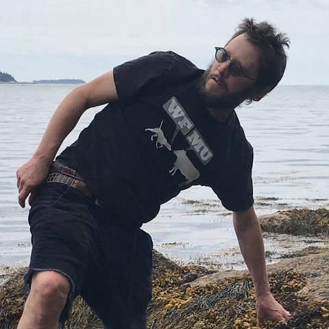
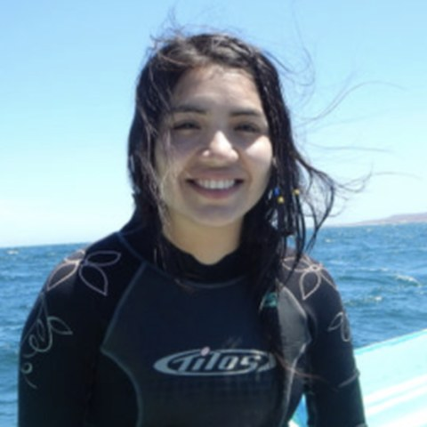
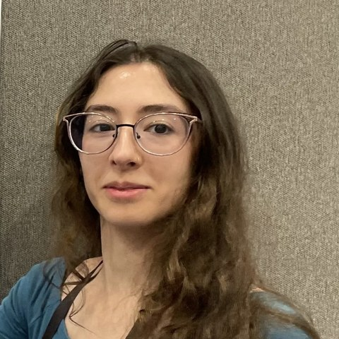
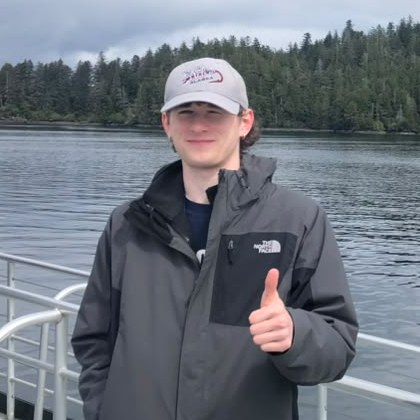

## Current

**Mike Hickerson**, PI  
Professor, Department of Biology, City College of New York. Faculty in the Ecology, Evolutionary Biology and Behavior PhD subprogram at the CUNY Graduate Center, and Research Associate in Invertebrate Zoology at the American Museum of Natural History.  
[Publications on Google Scholar](https://scholar.google.com/citations?hl=en&user=XaY6DN8AAAAJ&view_op=list_works&sortby=pubdate)

**Yamaly Barragán**, PhD candidate  
Species delimitation, demographic history, and color polymorphism in the sea anemone *Phymactis papillosa*.  
yamaly dot barragan at gmail dot com

**Esther Aruti**, PhD student  
Developing AI-based models that infer how whole ecological communities were assembled (dispersal, ecological drift, environmental filtering, species interactions) from the genomes of many co-occurring species. Also mapping the recombination landscape of *Asterias* sea star genomes.

**Matthew Messick**, MS student  
Dispersal and population genetics of feral pigeons (*Columba livia*) in the urban US Northeast, using iDDC modeling and SLiM spatial simulations.

## Alumni

### PhD students

- Melina Giakoumis (PhD 2023): Assistant Director, Institute for Comparative Genomics, American Museum of Natural History
- Connor French (PhD 2022): Sarepta Therapeutics
- Isaac Overcast (PhD 2019): University of Maine
- Alexander Xue (PhD 2017): postdoc with Adam Siepel, Cold Spring Harbor Laboratory
- Terry Demos (PhD 2014): Research Scientist, Field Museum of Natural History, Chicago
- JT Boehm (PhD 2014)

### Master's students

- Andrea Calderon Brito (MS 2022): PhD program at Tulane with Hannah Frank

### Postdocs

- Laura Bertola: Research Associate, National Centre for Biological Sciences (NCBS)
- Champak Beeravolu Reddy: Research Engineer, University of Fribourg
- Diego Alvarado-Serrano: Associate Professor, Ohio University
- John Robinson: postdoc, University of Georgia
- Katriina Ilves: Research Scientist, Canadian Museum of Nature, Ottawa
- Roberta Damasceno (visiting): Instituto de Biociências, Universidade de São Paulo

### Visiting students

- Luis Amador, from Guillermo D'Elía's lab, Universidad Austral de Chile
- Eduardo Schultz, from Camila Ribas's lab
- Victor Garcia-Olivares (2017), from Brent Emerson's lab, IPNA, La Laguna, Spain
- Pedro Taucce (2017), from Celio Haddad's lab, Unesp, Rio Claro, Brazil
- Vanessa Bonatti (2017), from Tiago Mauricio Francoy's lab, Universidade de São Paulo
- Natali Hurtado Miranda (2016), from Guillermo D'Elía's lab, Universidad Austral de Chile
- Gregory Thom (2016), from Cristina Miyaki's lab, Universidade de São Paulo: postdoc with Brian Smith, American Museum of Natural History
- Sara Lipshutz (2015), from the Derryberry lab, Tulane: Kim Rosvall's lab, Indiana University
- Cécile Gracianne (2014), University of Rennes, France
- Ana Christina Fazza (2013), from Cristina Miyaki's lab, Universidade de São Paulo: postdoc in the same lab
- Cedric Landerer (visiting master's student, 2013): postdoc, Max Planck Institute for Molecular Cell Biology and Genetics
- Stephen Harris, from the Munshi-South lab: Assistant Professor, SUNY Purchase

### Undergraduate and high school researchers

- Casey Sniffin (BS, CCNY 2018)
- Tyler Joseph (2014 to 2016): PhD at Columbia University with Itsik Pe'er
- Xiaoou Xie
- Wen Huang
- Tahira Sayed
- Chris Ludvik
- Francois Desinor
- Andrew Chen (Bronx High School of Science)

## Collaborators

Stephane Boissinot, Robb Brumfield, Lynsey Bunnefeld, Frank Burbrink, Ana Carnaval, Yvonne Chan, Elizabeth Derryberry, Brent Emerson, Ryan Gutenkunst, Konrad Lohse, Craig Moritz, Jason Munshi-South, Andy Rominger, Brian Smith, Graham Stone, Naoki Takebayashi.
